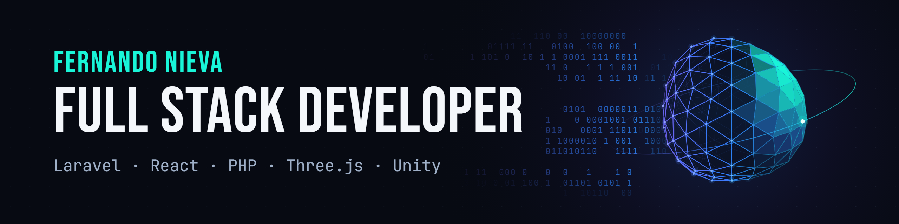

  

  <a href="https://www.linkedin.com/in/fernando-nievamx/">LinkedIn</a> · <a href="https://mrphoenix-999.itch.io/">Games on itch.io</a>

## About me

I'm a Full Stack Developer and 3D Generalist. I build web applications with Laravel and React, and interactive 3D experiences with Three.js and Unity.

I come from illustration, animation and 3D content creation (modeling, lighting, rendering), so I care about how software looks and feels as much as how it works. I'm currently studying the Tecnicatura Universitaria en Programación at UTN FRRe.

## Featured projects

### [Don Gato](https://github.com/Fernando-Nieva/Restaurante-DonGato)

Restaurant order management system with an interactive 3D dining room. Waiters pick a table on the 3D floor plan and send the order; the kitchen receives it instantly over WebSockets, and every status change updates the room and the board without a reload.

Includes role-based authorization, an admin panel with metrics and CSV export, a responsive touch interface, and adaptive graphics quality with a list-view fallback when WebGL isn't available.

`Laravel` `React` `Three.js` `Laravel Reverb` `Sanctum` `Docker`

### [Paprika](https://github.com/Fernando-Nieva/PaprikaIA)

Personal AI assistant with its own personality, long-term memory and a 22-step cognitive pipeline. It supports Ollama, Gemini, Groq, OpenAI and OpenRouter, plus web search, vision and audio.

`Node.js` `Express` `React` `SQLite` `Embeddings`

### [Comunidad Láser Chatbot](https://github.com/Fernando-Nieva/comunidad-laser-chatbot)

Prototype AI chatbot for a laser engraving and cutting community, running on local models with Ollama or a configurable external API.

`Laravel` `Livewire` `MySQL` `Ollama` `Pest`

### Games

Built with Unity and C#, and playable in the browser:

- **Devil Wheels:** [play](https://mrphoenix-999.itch.io/devilwheelsdmstk) · [source](https://github.com/Fernando-Nieva/DevilWheelsDmstk)
- **Galaxy Shooter:** a retro 2D arcade space shooter. [Play](https://mrphoenix-999.itch.io/galaxyshooter) · [source](https://github.com/Fernando-Nieva/GalaxyShooter-)

## Tech stack

| Area | Tools |
| --- | --- |
| **Backend** | PHP, Laravel, Node.js, Express, REST APIs, WebSockets |
| **Frontend** | JavaScript, React, Vite |
| **Data and infrastructure** | MySQL, SQLite, Docker |
| **3D and games** | Three.js, Unity, C#, 3D modeling, lighting, animation, rendering |

<picture>
  <source media="(prefers-color-scheme: dark)" srcset="https://raw.githubusercontent.com/Fernando-Nieva/Fernando-Nieva/output/github-snake-dark.svg">
  
</picture>
